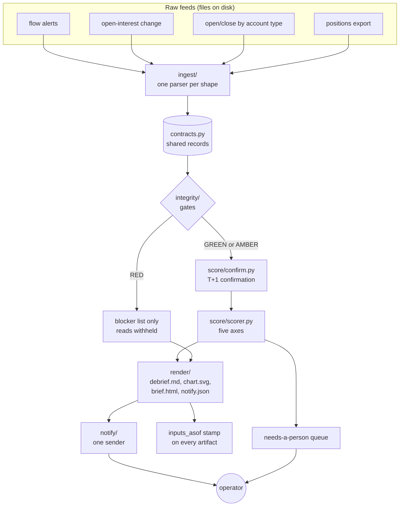

# Architecture

One direction of flow, one shared vocabulary, one gate that everything passes through.

## Data flow

## Module map

| Module | Responsibility | Knows about |
|---|---|---|
| `contracts.py` | The record model: `FlowAlert`, `OIChange`, `OpenClose`, `Position`, `PositionBook`, `Notification`. Cell parsers that tolerate blanks and dashes. | Nothing else |
| `config.py` | Every threshold and weight, by name. Neutral demo defaults. | Nothing else |
| `ingest/_csvio.py` | The defensive read all parsers share: byte-order mark, control characters, preamble, renamed columns. Raises on an unknown header. | `csv` |
| `ingest/flow_alerts.py` | Flow alerts to `FlowAlert`. | `contracts` |
| `ingest/oi_change.py` | Open-interest report to `OIChange`. Holds the dating rule. | `contracts` |
| `ingest/open_close.py` | Account-type report to `OpenClose`, from CSV or pasted text. Labels scope. | `contracts` |
| `ingest/positions.py` | Positions export to `PositionBook`, with file path, digest and timestamps. | `contracts` |
| `integrity/gates.py` | The checks, the verdict, and `require_pass`. | `config` |
| `integrity/provenance.py` | `inputs_asof` stamps and the stale-input check. | Files only |
| `score/confirm.py` | T+1 confirmation: publish window, end-of-day rule, verdict. | `config` |
| `score/scorer.py` | Five axes, a read, a score, the needs-a-person queue. Calls `require_pass` first. | `config`, `integrity` |
| `render/` | Four outputs from the same report and the same scored records. | `integrity`, `contracts` |
| `notify/sender.py` | The only code that can reach the network. De-duplicates RED pages. | `config` |
| `pipeline.py` | The order of operations. | All of the above |
| `synth.py` | A synthetic day and its hidden truth. Fault injectors. | `config`, `contracts` |
| `eval.py` | Gate scenarios and confirmation precision and recall. | `pipeline`, `synth` |
| `tools/public_gate.py` | Scans the tree for anything private before publishing. | Nothing in `flow_desk` |

## Where the gates sit

The gates run after ingest and before anything that produces a read. That position is deliberate.

- **After ingest**, because several checks need parsed records: zero rows, the dates inside the data, which held symbols have coverage.
- **Before confirmation and scoring**, because those steps turn inputs into confident-looking numbers. A stale feed scored is worse than a stale feed reported.
- **Enforced twice.** `pipeline.run` skips scoring on RED. `score_all` also calls `require_pass` itself and raises `IntegrityBlocked`, so a caller that bypasses the pipeline still cannot score on a RED report.

On RED the pipeline still renders and still notifies. What it renders is the blocker list. The chart is not written, and a chart left from an earlier run is deleted so it cannot sit next to a RED verdict.

## Three design rules that shape the code

**Parsers only parse.** Each `ingest` module reads a file and returns records. No scoring, no thresholds, no judgment. A vendor changing a column name is a one-file change.

**Scoring is pure.** `compute_verdict` and `score_alert` take records and return dicts. No files, no clock of their own, no network. That is why they test without fixtures and why the eval is deterministic.

**One way out.** Only `notify/sender.py` can reach the network, only to a URL supplied in the environment for that run, and it reports truthfully whether anything was sent.

## What the private desk has that this repo does not

This is a slice. The desk it was cut from also has a SQLite layer between ingest and scoring, a scheduler that runs the stages through the day, reconciliation of the positions store against each new export, and a language-model layer that reads the generated artifacts and writes the narrative brief. The rule for that last layer is the same rule this repo shows in code: Python owns everything mechanical, the model is asked only for judgment, and it must cite the artifact it read rather than recompute a number.
